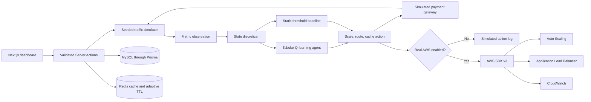

# Autonomous API Performance Optimization Framework for Digital Payment Gateways using Reinforcement Learning

A self-learning control loop that watches a simulated payment gateway's live metrics, autonomously decides scaling, routing, and caching actions, and measures itself against static rule-based scaling.

This repository is a college cloud architecture design project and a working simulation platform. It does not claim to operate a production payment gateway. Simulation mode is the default, every simulated infrastructure action is labeled and logged, and real AWS calls require an explicit opt-in.

## Presentation today

Run `npm run demo` and open `/dashboard/lab`. See [DEMO.md](DEMO.md) for the three-minute demonstration, custom traffic, evidence exports, test commands, and explicit implementation checklist. The lab needs no AWS credentials and uses the same Q-learning modules as the saved control loop. `npm run demo:backtest` regenerates seven scenario datasets and holdout-learning evidence.

## Abstract

Digital payment gateways handle millions of API requests every day, making performance, scalability, and reliability critical. Traditional API management systems rely on static configurations that cannot adapt efficiently to changing workloads, resulting in increased response time, server overload, and reduced user experience. This project proposes an Autonomous API Performance Optimization Framework that leverages Reinforcement Learning (RL) to dynamically optimize API performance in cloud environments. The framework continuously monitors system metrics such as response time, CPU utilization, memory usage, request rate, and network latency, and automatically determines the optimal scaling, routing, and caching strategies. Cloud services such as AWS Auto Scaling, Load Balancer, CloudWatch, and API Gateway are integrated to enable autonomous decision-making.

## Architecture



Each dashboard poll advances one deterministic simulator interval. The chosen action updates instance count, route weights, or cache TTL before the resulting metrics are calculated. This makes the action's effect visible in the next persisted observation.

## Features mapped to the innovation components

| Innovation component | Working implementation |
| --- | --- |
| AI-driven optimization vs conventional rules | `/dashboard/compare` feeds the same seed and demand waveform to the Q-learning agent and a static threshold controller. |
| RL decision-making without manual intervention | `lib/rl/qlearning.ts` implements epsilon-greedy tabular Q-learning and Bellman updates; comparison runs evaluate the frozen learned policy. |
| Predictive and dynamic resource adjustment | The state-action policy changes capacity before the post-action observation is generated. |
| Intelligent API routing | `REROUTE_SHIFT` moves 10% of traffic toward the least-loaded simulated pool. |
| Real-time monitoring | The dashboard polls a Server Action every 2.5 seconds and plots persisted observations. |
| Adaptive caching | `CACHE_TTL_UP` and `CACHE_TTL_DOWN` change both simulated cache behavior and the TTL used for the real Redis latest-state cache. |
| Self-learning improvement | The seeded setup pretrains on varied workloads, live RL runs continue learning from persisted visits, and Q-values plus epsilon are visible on `/dashboard/agent`. |
| Cost-aware resource management | The reward function penalizes normalized cost per request, while a scaling cooldown and capacity guard prevent wasteful action churn. |

The exact reward function is:

```text
reward = -w1 * normalizedLatency
         -w2 * slaViolationPenalty
         +w3 * normalizedThroughput
         -w4 * normalizedCostPerRequest
```

Default weights are latency `0.4`, SLA penalty `0.3`, throughput `0.2`, and cost `0.1`. Cost is normalized against `RL_COST_REFERENCE_PER_THOUSAND_USD` (`0.00004` by default). Settings are persisted in MySQL and must total `1.0`.

## Tech stack

| Layer | Technology |
| --- | --- |
| Framework | Next.js App Router, React, strict TypeScript |
| Data interface | Next.js Server Actions with Zod validation and discriminated results |
| UI | Tailwind CSS v4, shadcn/ui-style owned components, Radix primitives, Phosphor icons |
| Charts | Recharts |
| Database | Prisma ORM with MySQL, compatible with Amazon RDS for MySQL |
| Cache | Redis through ioredis |
| RL | Framework-independent TypeScript tabular Q-learning |
| Cloud integration | AWS SDK v3 for Auto Scaling, Elastic Load Balancing v2, and CloudWatch |
| Tests | Vitest unit tests |
| Packaging | Docker and Docker Compose |
| Package manager | npm with a committed `package-lock.json` |

## Setup - Local Development

### Prerequisites

- Node.js 22.13 or newer
- npm 10 or newer
- MySQL 8 compatible server
- Redis 7 compatible server
- Docker Desktop as the easiest way to run only MySQL and Redis locally

### Install and configure

```bash
git clone <your-repository-url>
cd autonomous-api-optimizer
npm install
cp .env.example .env
```

On Windows PowerShell, copy the environment template with:

```powershell
Copy-Item .env.example .env
```

The required local variables are:

| Variable | Purpose |
| --- | --- |
| `DATABASE_URL` | Prisma MySQL connection string. |
| `REDIS_URL` | Redis connection used for latest-state and Q-table caching. |
| `ADMIN_PASSWORD` | Password for `/settings`. |
| `SESSION_SECRET` | At least 32 characters, used to HMAC-sign the admin cookie. |
| `RL_EPSILON_START` | Initial exploration probability. |
| `RL_EPSILON_MIN` | Exploration floor. |
| `RL_EPSILON_DECAY` | Per-update decay multiplier. |
| `RL_LEARNING_RATE` | Bellman update learning rate. |
| `RL_DISCOUNT_FACTOR` | Future reward discount factor. |
| `RL_REWARD_WEIGHT_*` | Reward-function weights. They should sum to `1.0`. |
| `RL_COST_REFERENCE_PER_THOUSAND_USD` | Reference value used to normalize cost before applying its reward weight. |
| `SLA_TARGET_LATENCY_MS` | P95 latency target used by the reward function. |
| `MIN_INSTANCES`, `MAX_INSTANCES` | Simulation scale bounds. |
| `USE_REAL_AWS` | Defaults to `false`. See the AWS section before changing it. |

For `prisma migrate dev`, the MySQL account in `DATABASE_URL` must be allowed to create a temporary shadow database. A local administrator account is simplest for development; the Docker production path below uses `migrate deploy` and does not need that privilege.

Start MySQL and Redis using local installations, or run only the dependency services:

```bash
npm run services:up
```

Use `npm run services:status` to confirm both services are healthy. Keep the Compose `app` service stopped when using `npm run dev`; otherwise both application runtimes compete for port `3000`. If a previous full Compose run owns that port, release only the app container with `docker compose stop app`. MySQL, Redis, learned Q-values, and run history remain intact.

Apply the committed schema, seed the settings and pretrained policy, and start the app:

```bash
npm run db:generate
npm run db:migrate
npm run db:seed
npm run dev
```

`npm run db:migrate` runs `prisma migrate dev`, validates the committed migration against a shadow database, and applies it. To apply existing migrations without creating a shadow database, use `npx prisma migrate deploy` instead.

`npm run db:seed` pretrains a fresh Q-table for 1,000 deterministic episodes (288,000 Bellman updates) across several workload intensities. It does not replace an existing learned Q-table. To deliberately retrain and replace the policy while backing up the old entries, run `npm run rl:train -- --episodes=1000 --fresh --persist`.

Open `http://localhost:3000`. If MySQL, Redis, or a required environment variable is missing, Server Actions return a visible configuration or storage error instead of silently falling back to fake in-memory persistence.

If Next.js selects port `3001`, another process still owns port `3000`. The printed `Local` URL is valid, or stop the competing app process and restart `npm run dev` when a fixed port is preferred.

### Server Actions

The primary application interface lives in `app/actions.ts`:

- `startSimulation(mode, seed?)`
- `stopSimulation(runId)`
- `getLatestMetrics(runId)`
- `getAgentActionHistory(runId, page)`
- `getQTableSnapshot()`
- `updateRewardWeights(weights)`
- `resetQTable()`
- `toggleRealAws(enabled)`

All inputs are validated with Zod. Every action returns either `{ ok: true, data }` or `{ ok: false, error, code }`.

## Setup - Docker Compose

Copy the environment template, change the admin password and session secret, then run:

```bash
docker compose up --build
```

Compose starts the app, MySQL, and Redis; waits for both data services; applies the committed Prisma migration; seeds settings; and exposes the platform on `http://localhost:3000`.

To stop the stack without deleting learned state:

```bash
docker compose down
```

To intentionally delete the local MySQL and Redis volumes:

```bash
docker compose down --volumes
```

The second command is destructive and removes all local runs, logs, settings, and Q-values.

## Running the RL vs Baseline comparison

Use this repeatable sequence for a viva or demo day:

1. Open `/settings` and sign in with `ADMIN_PASSWORD`.
2. Confirm real AWS mode is off.
3. Keep the seeded Q-table for the scored comparison. Use `/dashboard` separately when demonstrating exploration and continued learning.
4. Open `/dashboard/compare`.
5. Enter a memorable seed such as `2026`.
6. Select **Run comparison** and allow at least 40 intervals to execute. Comparison mode freezes the Q-table and uses epsilon `0`, so the traffic seed cannot leak into learning.
7. Explain that both controllers receive the exact same `trafficDemand(seed, step)` values.
8. Compare P95 latency, throughput, SLA violations, cost per 1,000 requests, and controller state.
9. Open `/dashboard/agent` to show the persisted Q-values and visit counts used by the frozen policy.
10. Open `/dashboard/logs` to show persisted state, action, reward, and provider records.

Running the same seed with the same Q-table reproduces both the raw demand waveform and the comparison. Live `/dashboard` runs continue training at the persisted epsilon floor; `/dashboard/compare` never mutates the Q-table.

For a reproducible five-minute evidence run:

```bash
npm run backtest -- --duration-seconds=300 --interval-ms=2500 --seed=20260807
```

The command persists the matched run and writes `outputs/backtest-latest.md` plus `outputs/backtest-latest.json`.

## Testing

Run the framework-independent test suite:

```bash
npm test
```

Run compile-time checks:

```bash
npm run typecheck
npm run build
```

The Vitest suite covers the exact reward equation, SLA and throughput behavior, Bellman updates, persisted epsilon decay, constrained action selection, a learning-convergence sanity test, seeded reproducibility, scaling cooldown behavior, control boundaries, and the visible effect of scale actions. Run `npm run test:storage` for MySQL/Redis integration checks and `npm run test:e2e` for Playwright browser checks, including training, replay, downloads, custom-input errors, keyboard navigation and four viewport sizes.

## Enabling real AWS mode

Real AWS mode is a deliberate two-part safety gate:

1. Configure every AWS variable in `.env`, including both target groups and the listener rule used for weighted routing.
2. Set `USE_REAL_AWS=true` in the server environment **and** enable the persisted toggle from the password-protected Settings page. Real AWS ticks also require an authenticated administrator.

The implementation in `lib/aws/actions.ts` uses:

- `SetDesiredCapacityCommand` for scale actions.
- `ModifyRuleCommand` with weighted target groups for routing actions.
- `PutParameterCommand` (SSM) for cache-TTL actions; gateway instances poll the parameter.
- `PutMetricDataCommand` to publish optimizer telemetry to CloudWatch.

In real mode the agent also **observes** the live gateway instead of the simulator:
`lib/aws/observe.ts` scrapes a fleet-aggregated `/fleet` endpoint through the ALB and
`lib/aws/controlState.ts` reads the real desired capacity, routing weight, and cache TTL,
so decisions are driven by actual load. One tick is `lib/simulation/realTick.ts`, driven
either by the dashboard (admin-gated) or the headless `npm run controller -- <runId>`
(deliverable #10). Learning is temporal-difference across ticks because reality cannot be
re-simulated after acting.

**For the full end-to-end live demo** — a one-command CloudFormation stack (ALB, Auto
Scaling, ElastiCache, IAM, `$1` budget), the demo gateway, a k6 flood toolkit, and the
on-stage runbook — see [`aws/README.md`](aws/README.md). Validate readiness with
`npm run aws:check`.

**Warning:** Enabling real AWS mode with live credentials attempts real AWS API calls. Those calls can change infrastructure and incur cost. Use a dedicated sandbox account, least-privilege IAM policy, billing alarms, and non-production resources.

Recommended IAM permissions are limited to the named Auto Scaling group, ALB listener rule and target groups, plus `cloudwatch:PutMetricData` for the configured namespace.

## Known limitations

- **Cold-start training:** The local seed command performs deterministic offline pretraining, but a production policy must be trained and validated on representative sanitized traces rather than this simulator alone.
- **Exploration risk:** Live learning uses constrained epsilon-greedy exploration with persisted decay. Comparison mode disables exploration. A production deployment would still need canary rollout, approval gates, fallback policies, and automated rollback.
- **Reward-weight sensitivity:** Different latency, SLA, throughput, and cost weights can produce different policies. Weights require domain validation and sensitivity analysis.
- **Explainability:** The dashboard exposes the state bucket, selected action, Q-value, and reward, but tabular Q-learning does not provide causal explanations.
- **Simulation fidelity:** The workload is bursty, seeded, and action-responsive, but it is not a substitute for production traces, JMeter results, or AWS load tests.
- **Single process cadence:** Polling advances the simulator. A production deployment should move the control loop to a scheduled worker or queue consumer with distributed locking.
- **Browser automation:** Playwright covers the main demo and dashboard smoke paths; it is not exhaustive browser or failure-injection coverage.
- **Cloud hosting:** Direct TCP MySQL and Redis connections are designed for local Docker or a compatible Node runtime. A Cloudflare Worker deployment needs HTTP-compatible database and Redis providers or a D1-specific adapter.

## Future scope

- Multi-cloud failover across AWS, Azure, and Google Cloud.
- Fraud-aware reward shaping that balances performance with risk signals.
- One learning agent per microservice with a coordinator for shared capacity.
- Federated learning across gateway deployments without centralizing raw traffic.
- Offline training from sanitized CloudWatch and JMeter traces.
- Safe policy constraints, canary actions, and automatic rollback.
- Event-driven control loops through queues rather than browser polling.
